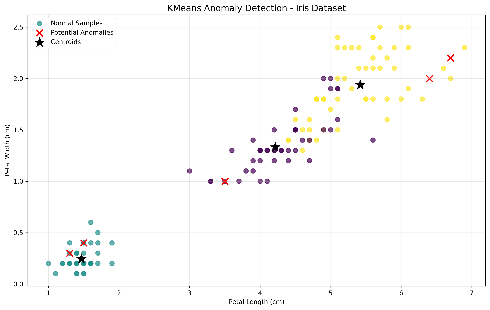

# KMeans Anomaly Detection

**A NumPy-based implementation of KMeans clustering and distance-based anomaly detection.**

An unsupervised machine learning project that implements the KMeans clustering algorithm from scratch using NumPy and applies statistical distance-based methods to identify potential anomalies in numerical datasets.

The project uses the Iris dataset as an experimental case study and demonstrates data preprocessing, iterative clustering, centroid-based distance calculation, anomaly detection, and visualization.

---

## Table of Contents

- [Overview](#overview)
- [Project Objectives](#project-objectives)
- [Features](#features)
- [Technologies](#technologies)
- [Dataset](#dataset)
- [Methodology](#methodology)
  - [1. Data Preprocessing](#1-data-preprocessing)
  - [2. KMeans Clustering](#2-kmeans-clustering)
  - [3. Distance Calculation](#3-distance-calculation)
  - [4. Anomaly Detection](#4-anomaly-detection)
- [Experimental Results](#experimental-results)
- [Project Structure](#project-structure)
- [Installation](#installation)
- [Usage](#usage)
- [Output Files](#output-files)
- [Implementation Details](#implementation-details)
- [Limitations](#limitations)
- [Future Improvements](#future-improvements)
- [References](#references)
- [Author](#author)

---

## Overview

Anomaly detection is a data analysis technique used to identify observations that deviate significantly from the general patterns of a dataset.

This project explores how KMeans clustering can be applied to distance-based anomaly detection.

Instead of relying on predefined class labels, the implementation groups observations according to their numerical similarities. It then calculates the distance between each observation and its assigned cluster centroid.

Observations whose distances exceed their cluster-specific thresholds are classified as potential anomalies.

The KMeans algorithm is independently implemented using NumPy rather than directly calling an existing clustering implementation from Scikit-learn.

## Project Objectives

The main objectives are:

1. Understand the fundamental principles of unsupervised learning and anomaly detection.
2. Implement the KMeans clustering algorithm using NumPy.
3. Apply Euclidean distance to measure the similarity between observations and cluster centroids.
4. Develop a statistical criterion for identifying potential anomalies.
5. Visualize clustering and anomaly detection results.
6. Evaluate the implementation using an existing numerical dataset.

## Features

- **Custom KMeans implementation:** Implements centroid initialization, cluster assignment, centroid updating, and iterative convergence using NumPy.
- **Data standardization:** Normalizes numerical features to ensure comparable scales during distance calculations.
- **Euclidean distance:** Measures the distance between each observation and its assigned centroid.
- **Cluster-specific anomaly detection:** Uses Median Absolute Deviation (MAD) to establish individual distance thresholds for each cluster.
- **Data visualization:** Displays cluster assignments, potential anomalies, and centroids using Matplotlib.
- **CSV export:** Saves detection results and numerical measurements for further analysis.
- **Reproducibility:** Uses a fixed random seed for consistent centroid initialization.

## Technologies

| Technology | Purpose |
|---|---|
| Python 3.12+ | Main programming language |
| NumPy | Numerical calculations and custom KMeans implementation |
| Matplotlib | Data visualization |
| Scikit-learn | Loading the Iris dataset only |

**Implementation note:** Scikit-learn's `KMeans` implementation is not used. The clustering algorithm is implemented independently using NumPy.

## Dataset

### Iris Dataset

The experiment uses the Iris dataset, a commonly used dataset in machine learning.

It contains 150 flower observations, each described by four numerical features.

| Feature | Description |
|---|---|
| Sepal length | Length of the sepal |
| Sepal width | Width of the sepal |
| Petal length | Length of the petal |
| Petal width | Width of the petal |

Dataset characteristics:

- Number of observations: 150
- Number of numerical features: 4
- Original species categories: 3
- Missing numerical values: None in the standard dataset

The original species labels are deliberately excluded from the clustering process.

Only the numerical measurements are used as input to the KMeans algorithm. This allows the clustering process to operate without predefined class information.

**Important:** The Iris dataset is primarily a classification dataset rather than a dataset containing verified anomalies. Therefore, the detected observations are treated as potential anomalies, not confirmed abnormal samples.

## Methodology

The experiment consists of four main stages.

### 1. Data Preprocessing

The four numerical features have different measurement ranges.

To prevent features with larger numerical values from disproportionately influencing Euclidean distance calculations, standardization is performed.

The standardization formula is:

\[
z = \frac{x-\mu}{\sigma}
\]

Where:

- \(x\) represents the original feature value.
- \(\mu\) represents the feature mean.
- \(\sigma\) represents the feature standard deviation.
- \(z\) represents the standardized value.

The standardized dataset is subsequently used as input to KMeans.

### 2. KMeans Clustering

KMeans divides a dataset into \(K\) clusters by minimizing the within-cluster sum of squared distances.

The implementation follows these steps:

1. Initialize \(K\) centroids by randomly selecting observations from the dataset.
2. Calculate the Euclidean distance between every observation and each centroid.
3. Assign each observation to its nearest centroid.
4. Recalculate each centroid using the mean position of its assigned observations.
5. Repeat the assignment and updating procedures until convergence or the maximum iteration limit is reached.

The Euclidean distance is defined as:

\[
d(x,c)=\sqrt{\sum_{j=1}^{n}(x_j-c_j)^2}
\]

Where:

- \(x\) represents an observation.
- \(c\) represents a centroid.
- \(n\) represents the number of features.
- \(d(x,c)\) represents their Euclidean distance.

The experiment uses:

| Parameter | Value |
|---|---|
| Number of clusters (\(K\)) | 3 |
| Maximum iterations | 100 |
| Convergence tolerance | 0.0001 |
| Random seed | 42 |

### 3. Distance Calculation

After clustering, the Euclidean distance between each observation and its assigned centroid is calculated.

A larger distance indicates that an observation is farther away from the center of its assigned cluster.

These distances provide the basis for the anomaly detection procedure.

### 4. Anomaly Detection

The implementation uses a cluster-specific Median Absolute Deviation (MAD) threshold.

MAD is a robust statistical measure of dispersion.

For each cluster, the following values are calculated:

**Median distance:**

\[
M_c = \operatorname{median}(D_c)
\]

**Median Absolute Deviation:**

\[
MAD_c =
\operatorname{median}(|D_c-M_c|)
\]

**Anomaly threshold:**

\[
T_c = M_c + 3(1.4826 \times MAD_c)
\]

Where:

- \(D_c\) represents the distances within cluster \(c\).
- \(M_c\) represents the median distance.
- \(MAD_c\) represents the median absolute deviation.
- \(T_c\) represents the anomaly threshold.

The factor 1.4826 is a consistency factor commonly used when relating MAD to standard deviation under a normal distribution.

An observation is classified as a potential anomaly when:

\[
d(x,c)>T_c
\]

If MAD is approximately zero, the implementation uses the 97.5th percentile of that cluster's distances as a fallback threshold.

This method evaluates observations relative to their own clusters rather than applying a single global threshold.

## Experimental Results

The program generates a two-dimensional visualization using petal length and petal width.

Although all four numerical features are used during clustering, only two features are displayed in the graph for visualization purposes.

### Clustering and Anomaly Detection



**Figure 1.** KMeans clustering and distance-based anomaly detection on the Iris dataset.

The visualization includes:

- Colored points representing cluster assignments.
- Red cross markers representing potential anomalies.
- Black star markers representing cluster centroids.

The experimental output demonstrates that the implementation can discover clusters without using the original species labels and identify observations with unusually large distances from their assigned centroids.

The numerical detection results are exported to a CSV file for further inspection.

**Interpretation note:** A large distance from a centroid does not necessarily indicate a genuinely abnormal observation. The results represent statistical deviations according to the selected detection criterion.

## Project Structure

```text
KMeans-Anomaly-Detection/
│
├── kmeans.py
│   └── Custom KMeans implementation
│
├── main.py
│   └── Main experiment and anomaly detection
│
├── requirements.txt
│   └── Project dependencies
│
├── README.md
│   └── Project documentation
│
├── .gitignore
│   └── Git exclusion rules
│
├── anomaly_detection_result.png
│   └── Experimental visualization
│
└── anomaly_results.csv
    └── Exported anomaly detection results
```

## Installation

### Prerequisites

- Python 3.12 or later
- pip
- Git (optional, for cloning the repository)

### 1. Clone the repository

```bash
git clone YOUR_REPOSITORY_URL
```

Navigate into the project directory:

```bash
cd KMeans-Anomaly-Detection
```

### 2. Create a virtual environment

```bash
python -m venv .venv
```

### 3. Activate the virtual environment

**Windows PowerShell:**

```powershell
.venv\Scripts\Activate.ps1
```

**macOS / Linux:**

```bash
source .venv/bin/activate
```

### 4. Install dependencies

```bash
python -m pip install -r requirements.txt
```

## Usage

After installing the dependencies, execute:

```bash
python main.py
```

The program will:

1. Load the Iris dataset.
2. Standardize the numerical features.
3. Execute the custom KMeans algorithm.
4. Calculate distances to assigned centroids.
5. Apply cluster-specific anomaly thresholds.
6. Display potential anomalies.
7. Export the numerical results.
8. Generate the visualization.

## Output Files

### `anomaly_detection_result.png`

A graphical representation of the clustering and anomaly detection results.

### `anomaly_results.csv`

A CSV file containing the detection results for all observations.

The exported columns include:

| Column | Description |
|---|---|
| sample_index | Original observation index |
| cluster | Assigned cluster |
| distance | Distance to assigned centroid |
| threshold | Applicable cluster-specific threshold |
| is_anomaly | Anomaly indicator (1 = potential anomaly, 0 = otherwise) |
| sepal length (cm) | Original sepal length |
| sepal width (cm) | Original sepal width |
| petal length (cm) | Original petal length |
| petal width (cm) | Original petal width |

## Implementation Details

The custom implementation is located in `kmeans.py`.

The following NumPy operations are used:

| Function | Purpose |
|---|---|
| `np.array()` | Represents numerical datasets |
| `np.random.default_rng()` | Initializes reproducible random selection |
| `np.linalg.norm()` | Calculates Euclidean distances |
| `np.argmin()` | Identifies the nearest centroid |
| `np.mean()` | Updates centroid positions |
| `np.median()` | Calculates median distances |
| `np.percentile()` | Provides a fallback threshold |

The main experiment is implemented in `main.py`, which handles dataset loading, preprocessing, clustering, anomaly detection, visualization, and CSV export.

## Limitations

The current implementation has several limitations:

1. **Predefined cluster count:** KMeans requires the number of clusters to be specified before execution.
2. **Initialization sensitivity:** Different centroid initializations may produce different clustering results.
3. **Distance-based assumptions:** Points far from their centroids are not necessarily genuine anomalies.
4. **Dataset limitations:** Iris does not contain verified anomaly labels, making direct evaluation of detection accuracy difficult.
5. **Cluster shape:** KMeans works best when clusters are reasonably compact and separated.
6. **Threshold selection:** The MAD multiplier and fallback percentile influence the number of detected anomalies.

These limitations should be considered when interpreting the experimental results.

## Future Improvements

Possible extensions include:

- Implementing KMeans++ initialization.
- Comparing different values of \(K\).
- Evaluating alternative anomaly detection thresholds.
- Comparing MAD with interquartile range (IQR) and standard deviation-based methods.
- Adding PCA for dimensionality reduction and visualization.
- Evaluating the implementation on datasets containing verified anomalies.
- Adding automated unit tests and performance comparisons.

## References

- NumPy Documentation: https://numpy.org/doc/
- Matplotlib Documentation: https://matplotlib.org/stable/
- Scikit-learn Documentation: https://scikit-learn.org/stable/
- Iris Dataset: https://scikit-learn.org/stable/modules/generated/sklearn.datasets.load_iris.html

## Author

lottabytes

---

*This project was developed as a practical exploration of unsupervised machine learning, KMeans clustering, and statistical anomaly detection.*